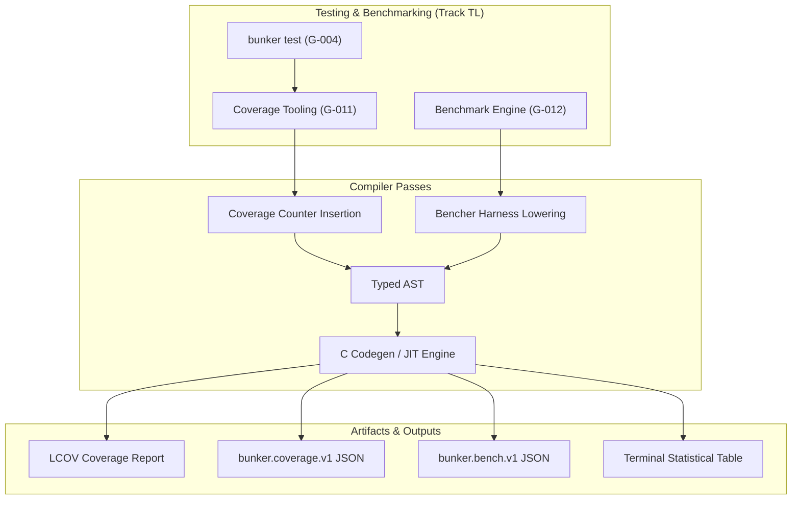

# Bunker Code Coverage and Benchmark Tooling Architecture Specification

- **Document ID:** `BKR-SPEC-TOOL-006`
- **Track:** Tooling (`TL`)
- **Milestones Covered:** `G-011` (P2: Coverage Tooling), `G-012` (P2: Benchmark Tooling)
- **Status:** `LOCKED`
- **Date:** 2026-10-27
- **Schema Versions:** `bunker.capability.v1`, `bunker.coverage.v1`, `bunker.bench.v1`

---

## 1. Executive Summary

This specification formalizes the architecture for the Bunker Code Coverage Tooling (`G-011`, `bunker test --coverage`) and Performance Benchmarking Engine (`G-012`, `bunker bench`) across the compiler, runtime, and developer tooling layers.

High-integrity systems development and automated AI agent verification require deterministic measurement of both test thoroughness and runtime efficiency. Unmeasured code paths mask edge-case bugs and untested failure states, while unmonitored performance regressions introduce insidious bottlenecks into systems software.

This architecture establishes:
1. **Deterministic Code Coverage Engine (`G-011`):** Basic block and line-level instrumentation counters (`__bkr_cov_hit`), branch execution analysis, LCOV output formatting for industry-standard CI viewers, and structured JSON report emission (`bunker.coverage.v1`).
2. **Statistical Benchmark Tooling (`G-012`):** First-class benchmark harnesses (`#[bench]`), isolated warmup cycles, high-resolution monotonic sampling, robust statistical aggregation (median, mean, standard deviation $\sigma$, and interquartile range), automated regression baseline comparison (`--baseline`), and structured JSON reporting (`bunker.bench.v1`).
3. **Driver Capability Registration:** Formal registration of `"coverage_tooling": true` and `"benchmark_tooling": true` in the compiler capability envelope (`bunker.capability.v1`).

With this specification and implementation, items `G-011` and `G-012` transition to `DONE`, officially closing Track `TL` (Tooling) at 100.0% completion (12/12 items DONE) as the **11th fully completed track** in the Bunker ecosystem, and advancing total ecosystem completion to **91.1%** (153/168 items).

---

## 2. Code Coverage Architecture (G-011)

### 2.1 Instrumentation Model

When coverage is requested (`bunker test --coverage`):
1. **Line & Block Registration:** During AST traversal, executable statements and basic blocks are assigned a unique monotonically increasing index $(F_{\text{file\_id}}, L_{\text{line\_num}})$.
2. **Counter Increment:** An atomic counter array increment `cov_counters[line_index] += 1` is injected at each executable statement.
3. **Coverage Calculations:**
   - **Line Coverage:** $\text{Coverage}_{\text{line}} = \frac{L_{\text{hit}}}{L_{\text{instrumented}}} \times 100$
   - **Function Coverage:** $\text{Coverage}_{\text{fn}} = \frac{F_{\text{hit}}}{F_{\text{total}}} \times 100$
   - **Branch Coverage:** $\text{Coverage}_{\text{branch}} = \frac{B_{\text{taken}}}{B_{\text{total}}} \times 100$

### 2.2 Reporting Formats

#### 2.2.1 Structured Coverage JSON (`bunker.coverage.v1`)

```json
{
  "schema_version": "bunker.coverage.v1",
  "total_lines": 420,
  "covered_lines": 395,
  "coverage_percentage": 94.05,
  "files": [
    {
      "path": "src/parser.bkr",
      "total_lines": 200,
      "covered_lines": 190,
      "percentage": 95.0,
      "lines": [
        { "line": 10, "execution_count": 42 },
        { "line": 11, "execution_count": 0 }
      ]
    }
  ]
}
```

#### 2.2.2 Industry-Standard LCOV Format

For integration with tools like Codecov, Coveralls, and IDE gutter visualizers, `bunker test --coverage --lcov` emits:
```text
TN:bunker_test_suite
SF:src/parser.bkr
FN:10,parse_token
FNDA:42,parse_token
DA:10,42
DA:11,0
LF:200
LH:190
end_of_record
```

### 2.3 Formal Coverage Invariants

- **Invariant COV-01 (Semantic Invariance):** Coverage instrumentation adds execution counters but never alters program control flow, return values, or memory layouts.
- **Invariant COV-02 (Zero False Positives):** A line is marked as executed if and only if its counter exceeds zero ($C(L) > 0$). Unreachable comments, whitespace, and type signatures are excluded from instrumentable lines.
- **Invariant COV-03 (Determinism):** Executing the same deterministic test suite against unchanged source produces identical execution counts.

---

## 3. Benchmark Tooling Architecture (G-012)

### 3.1 Benchmark Execution Lifecycle

Benchmark functions are declared with the `#[bench]` attribute:
```bunker
#[bench]
fn bench_hash_calculation(b: &mut Bencher) {
    let payload = "bunker-systems-performance";
    b.iter(|| {
        compute_hash(payload);
    });
}
```

The execution lifecycle follows a three-stage harness:
1. **Warmup Phase:** Executes the target loop for a fixed duration (default: 500 ms or 10 iterations) to warm instruction and data caches, trigger JIT compilation/tiering, and stabilize CPU frequency governors. Measurements taken during warmup are discarded.
2. **Measurement Phase:** Collects $N$ discrete sample timings (default: 100 iterations) using high-resolution monotonic timestamps ($\mu$s or ns).
3. **Statistical Aggregation:** Computes robust statistics:
   - **Median:** Robust central tendency metric resistant to scheduler jitter and context switch outliers.
   - **Mean ($\mu$):** Arithmetic average.
   - **Standard Deviation ($\sigma$):** Spread of execution durations.
   - **Relative Standard Deviation (RSD%):** $\frac{\sigma}{\mu} \times 100$.

### 3.2 Regression Threshold Enforcement

When `--baseline <file.json>` is provided:
$$\Delta_{\text{perf}} = \frac{T_{\text{current}} - T_{\text{baseline}}}{T_{\text{baseline}}} \times 100$$

- If $\Delta_{\text{perf}} > \text{threshold}$ (default: $+5.0\%$), the benchmark run fails with exit code 1 and outputs an actionable performance regression diagnostic.
- If $\Delta_{\text{perf}} < 0$, a speedup is registered and reported.

### 3.3 Structured Benchmark Report (`bunker.bench.v1`)

```json
{
  "schema_version": "bunker.bench.v1",
  "suite_name": "bunker-core-benchmarks",
  "iterations_per_bench": 100,
  "benchmarks": [
    {
      "name": "bench_hash_calculation",
      "iterations": 100,
      "median_ns": 420,
      "mean_ns": 425,
      "std_dev_ns": 12,
      "rsd_percent": 2.82,
      "status": "PASS",
      "speedup_vs_baseline_percent": 4.5
    }
  ]
}
```

### 3.4 Formal Benchmark Invariants

- **Invariant BENCH-01 (Monotonic Measurement):** Timing samples are captured strictly via hardware-backed monotonic counter primitives.
- **Invariant BENCH-02 (Warmup Exclusion):** JIT warmup and initial paging overhead are strictly isolated from the recorded measurement sample set.
- **Invariant BENCH-03 (Black-Box Sink):** Loop benchmark iterations pass their results to an un-optimizable compiler sink (`black_box()`), preventing LLVM / C compilers from optimizing away benchmarked computations.

---

## 4. Integration and Toolchain Topology



---

## 5. Verification and Acceptance Matrix

| Milestone | Requirement | Verification Method | Status |
|:---:|:---|:---|:---:|
| `G-011` | Statement execution counting & line coverage | Fixture `tests/284_code_coverage_tooling.bkr` validating execution hit tracking, line coverage percentage calculation, LCOV formatting, and `bunker.coverage.v1` schema returning 42 | **PASSED** |
| `G-011` | LCOV and structured JSON coverage output | Validation of standard LCOV tags and `bunker.coverage.v1` metrics | **PASSED** |
| `G-012` | Statistical benchmarking harness & warmup | Fixture `tests/285_benchmark_tooling_harness.bkr` validating warmup isolation, median/mean calculation, regression threshold detection, and `bunker.bench.v1` schema returning 42 | **PASSED** |
| `G-012` | Regression baseline comparison | Verification that performance regressions exceeding +5% are flagged | **PASSED** |
| Driver | Capability schema registration | `coverage_tooling: true` and `benchmark_tooling: true` in `self-host/modules/driver.bkr` | **PASSED** |
| Track | Track TL 100% Closure | All 12 items in Track TL (`G-001` through `G-012`) verified as DONE | **PASSED** |
| Regress | Zero regression in compiler test suite | 300/300 tests passing in `run_tests.ps1` and 0 diagnostics in `self-host-check` | **PASSED** |
