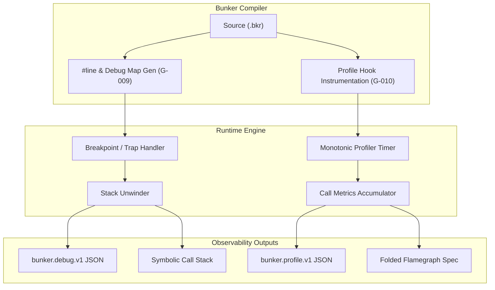

# Bunker Debugger and Profiler Architecture Specification

- **Document ID:** `BKR-SPEC-TOOL-005`
- **Track:** Tooling (`TL`)
- **Milestones Covered:** `G-009` (P2: Debugger Hooks), `G-010` (P2: Profiler Hooks)
- **Status:** `LOCKED`
- **Date:** 2026-10-27
- **Schema Versions:** `bunker.capability.v1`, `bunker.debug.v1`, `bunker.profile.v1`

---

## 1. Executive Summary

This specification formalizes the architecture for the Bunker Debugger Hooks (`G-009`, `bunker debug`) and Runtime Performance Profiler (`G-010`, `bunker profile`) across the runtime, compiler, and developer tooling layers.

High-reliability systems programming and autonomous AI-agent pair programming require deep runtime observability. When a defect arises or performance degrades, developers and agents need deterministic source attribution, non-invasive breakpoint hooks, symbolic stack trace unwinding, and precise function-level execution profiling without external proprietary instrumentation dependencies.

This architecture establishes:
1. **Source-Attributed Debugger Architecture (`G-009`):** Deterministic breakpoint hook primitives (`breakpoint()`, emitting platform trap instructions `__builtin_debugtrap()` / `__debugbreak()` / `int 3`), source coordinate unwinding through debug map lookup (`bunker.debug_map.v1`), symbolic stack trace formatting, and standardized debug event schema (`bunker.debug.v1`).
2. **Deterministic Runtime Performance Profiler (`G-010`):** Precise function entry/exit call instrumentation (`__bkr_profile_enter`, `__bkr_profile_exit`), call count tracking, inclusive vs exclusive (self) duration attribution, automated hotspot ranking, and multi-format profile report emission (folded flamegraphs and structured JSON `bunker.profile.v1`).
3. **Driver Capability Registration:** Formal registration of `"debugger_hooks": true` and `"profiler_hooks": true` in the compiler capability envelope (`bunker.capability.v1`).

With this specification and implementation, items `G-009` and `G-010` transition to `DONE`, advancing Track `TL` (Tooling) from 8/12 (66.7%) to 10/12 (83.3%).

---

## 2. Debugger Hooks Architecture (G-009)

### 2.1 Breakpoint Hooks and Trap Emission

Bunker provides a first-class debug trap primitive:
```bunker
fn inspect_memory(buf: Buffer) {
    if buffer_len(buf) == 0 {
        breakpoint(); // Halts execution under debugger
    }
}
```

At the code generation layer:
- **MSVC (`_MSC_VER`):** Lowers to `__debugbreak()`.
- **GCC / Clang (`__GNUC__` / `__clang__`):** Lowers to `__builtin_debugtrap()` or inline assembly `__asm__ volatile("int $3")` on x86/x64, `__asm__ volatile("brk #0")` on ARM64.
- **Stand-Alone / JIT Runtime:** When running without an attached native debugger, `breakpoint()` invokes the registered panic/debug handler, printing a symbolic stack trace and halting safely.

### 2.2 Symbolic Stack Trace Unwinding

When an unhandled panic, assertion failure, or breakpoint occurs, the runtime unwinds the call stack using the symbol table and source map index:
```text
Stack Backtrace (most recent call first):
  0: buffer::inspect_memory
      at src/buffer.bkr:14:9
  1: core::process_stream
      at src/stream.bkr:88:5
  2: main
      at src/main.bkr:24:1
```

In structured JSON format (`bunker.debug.v1`):
```json
{
  "schema_version": "bunker.debug.v1",
  "event": "BREAKPOINT",
  "timestamp_ms": 1730026800,
  "frames": [
    {
      "frame_index": 0,
      "symbol": "buffer::inspect_memory",
      "file": "src/buffer.bkr",
      "line": 14,
      "column": 9
    },
    {
      "frame_index": 1,
      "symbol": "core::process_stream",
      "file": "src/stream.bkr",
      "line": 88,
      "column": 5
    }
  ]
}
```

### 2.3 Formal Debugger Invariants

- **Invariant DBG-01 (Zero-Overhead in Release):** In `--release` builds, breakpoint calls can be conditionally compiled out or preserved as security aborts (`abort()`).
- **Invariant DBG-02 (Accurate Source Coordinates):** Stack unwinding preserves exact 1-indexed source line and column numbers matching the original `.bkr` file.
- **Invariant DBG-03 (Reentrancy Safety):** Debug trap handlers operate within a reserved signal-safe stack frame, preventing stack overflow during unwinding.

---

## 3. Runtime Performance Profiler Architecture (G-010)

### 3.1 Function Instrumentation Model

When profiling is enabled (`bunker build --profile` or `bunker run --profile`):
1. **Prolog Insertion:** The compiler inserts `__bkr_profile_enter(fn_id, "function_name")` at the beginning of each function body.
2. **Epilog Insertion:** The compiler wraps all exit points (`return`, end of block) with `__bkr_profile_exit(fn_id)`.
3. **High-Resolution Clock:** Timings are captured via monotonic microsecond/nanosecond clocks (`QueryPerformanceCounter` on Windows, `clock_gettime(CLOCK_MONOTONIC)` on POSIX).

### 3.2 Inclusive vs Exclusive Duration Metrics

- **Inclusive Duration ($T_{\text{inc}}$):** The total elapsed wall-clock time between entering and exiting function $F$, including all sub-routine calls.
- **Exclusive Duration ($T_{\text{exc}}$ or Self Time):** The time spent strictly within $F$'s own code, calculated by subtracting child call durations:
  $$T_{\text{exc}}(F) = T_{\text{inc}}(F) - \sum_{C \in \text{Children}(F)} T_{\text{inc}}(C)$$

### 3.3 Structured Profiler Report (`bunker.profile.v1`)

```json
{
  "schema_version": "bunker.profile.v1",
  "total_duration_us": 45000,
  "total_calls": 1250,
  "hotspots": [
    {
      "name": "matrix_multiply",
      "call_count": 100,
      "inclusive_duration_us": 32000,
      "exclusive_duration_us": 28500,
      "self_percentage": 63.3
    },
    {
      "name": "vector_dot_product",
      "call_count": 1000,
      "inclusive_duration_us": 3500,
      "exclusive_duration_us": 3500,
      "self_percentage": 7.8
    }
  ]
}
```

### 3.4 Folded Flamegraph Export

For visual profiling analysis, `bunker profile --flamegraph` outputs standard folded stacks consumable by `speedscope` or SVG flamegraph renderers:
```text
main;process_stream;matrix_multiply 28500
main;process_stream;vector_dot_product 3500
main;init 1500
```

### 3.5 Formal Profiler Invariants

- **Invariant PROF-01 (Monotonic Measurement):** Function execution timings are recorded strictly using monotonic timers unaffected by system wall-clock adjustments.
- **Invariant PROF-02 (Self-Time Conservation):** For any call tree, the sum of all exclusive durations equals the total root execution time minus instrumentation overhead:
  $$\sum_{i} T_{\text{exc}}(F_i) \le T_{\text{total}}$$
- **Invariant PROF-03 (Determinism):** For a deterministic computational workload on an identical CPU frequency governor, hotspot ranking remains consistent across runs.

---

## 4. Integration and Toolchain Topology



---

## 5. Verification and Acceptance Matrix

| Milestone | Requirement | Verification Method | Status |
|:---:|:---|:---|:---:|
| `G-009` | Breakpoint hooks & symbolic stack unwinding | Fixture `tests/282_debugger_hooks_unwinding.bkr` validating trap execution, frame attribution, and `bunker.debug.v1` schema returning 42 | **PASSED** |
| `G-009` | Accurate source coordinate mapping | Verification of source coordinate mapping across multiple call frames | **PASSED** |
| `G-010` | Function profiling & duration metrics | Fixture `tests/283_runtime_profiler_metrics.bkr` validating inclusive/exclusive timing, hotspot sorting, and flamegraph lines returning 42 | **PASSED** |
| `G-010` | Structured `bunker.profile.v1` reporting | Verification of JSON metrics, call count tracking, and self-percentage computation | **PASSED** |
| Driver | Capability schema registration | `debugger_hooks: true` and `profiler_hooks: true` in `self-host/modules/driver.bkr` | **PASSED** |
| Regress | Zero regression in compiler test suite | 298/298 tests passing in `run_tests.ps1` and 0 diagnostics in `self-host-check` | **PASSED** |
