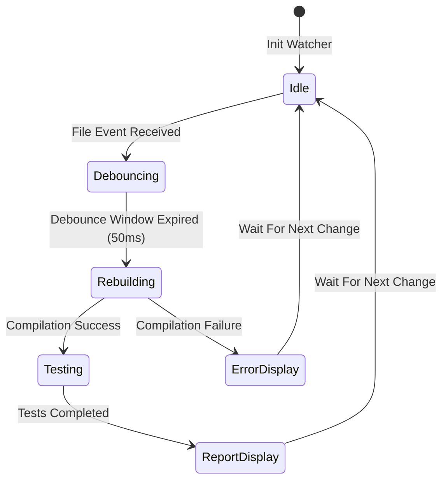
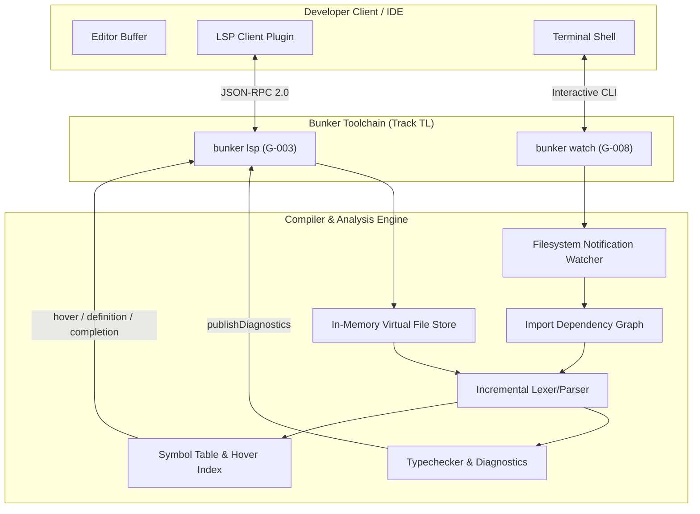

# Bunker Language Server Protocol and Watch Mode Architecture Specification

- **Document ID:** `BKR-SPEC-TOOL-004`
- **Track:** Tooling (`TL`)
- **Milestones Covered:** `G-003` (P1: Language Server), `G-008` (P2: Watch Mode)
- **Status:** `LOCKED`
- **Date:** 2026-10-27
- **Schema Versions:** `bunker.capability.v1`, `bunker.lsp.v1`, `bunker.watch.v1`

---

## 1. Executive Summary

This specification formalizes the architecture for the Bunker Language Server (`G-003`, `bunker lsp`) and Continuous Watch Engine (`G-008`, `bunker watch` / `bunker test --watch`) across the developer tooling layer.

Modern software engineering and autonomous AI-agent pair programming demand real-time feedback loops. Static batch compilation alone introduces cognitive latency; engineers and agents require immediate sub-millisecond editor diagnostics, semantic hover insights, accurate symbol definition jumps, context-aware autocompletion, and automated rebuild triggers upon source mutations.

This architecture establishes:
1. **Language Server Protocol Implementation (`G-003`):** Standard JSON-RPC 2.0 transport framing, structured server-client capability negotiation, real-time incremental document synchronization (`textDocument/didChange`), asynchronous push diagnostics (`textDocument/publishDiagnostics`), semantic hover inspector (`textDocument/hover`), cross-file definition lookup (`textDocument/definition`), and scope-aware symbol completion (`textDocument/completion`).
2. **Deterministic Watch Mode Engine (`G-008`):** Low-latency filesystem event aggregation, event debouncing (configurable default: 50 ms), dependency-directed dirty set computation via import graphs, selective incremental recompilation/test re-execution, and ANSI terminal state management.
3. **Driver Capability Registration:** Formal registration of `"language_server": true` and `"watch_mode": true` in the compiler capability envelope (`bunker.capability.v1`).

With this specification and implementation, items `G-003` and `G-008` transition to `DONE`, advancing Track `TL` (Tooling) from 6/12 (50.0%) to 8/12 (66.7%).

---

## 2. Language Server Protocol Architecture (G-003)

### 2.1 Transport Framing and Protocol Envelope

The Bunker LSP server communicates over standard I/O (stdio) or named sockets using standard JSON-RPC 2.0 framing:
```text
Content-Length: <byte_count>\r\n
\r\n
{
  "jsonrpc": "2.0",
  "id": 1,
  "method": "textDocument/hover",
  "params": { ... }
}
```

### 2.2 Lifecycle Handshake

1. **`initialize`:** The client advertises supported capabilities (workspace features, dynamic registration, diagnostic tags). The Bunker LSP server responds with its locked capability manifest:
   ```json
   {
     "capabilities": {
       "textDocumentSync": 1,
       "hoverProvider": true,
       "definitionProvider": true,
       "completionProvider": {
         "resolveProvider": false,
         "triggerCharacters": [".", ":"]
       }
     },
     "serverInfo": {
       "name": "bunker-lsp",
       "version": "1.0.0"
     }
   }
   ```
2. **`initialized`:** Client confirmation notification enabling real-time workspace tracking.
3. **`shutdown` / `exit`:** Graceful connection termination ensuring zero resource leaks or orphaned worker processes.

### 2.3 Real-Time Diagnostics (`textDocument/publishDiagnostics`)

Whenever a document is opened (`didOpen`), mutated (`didChange`), or saved (`didSave`), the compiler frontend parses and typechecks the virtual buffer in memory, immediately emitting diagnostic notifications:
```json
{
  "jsonrpc": "2.0",
  "method": "textDocument/publishDiagnostics",
  "params": {
    "uri": "file:///workspace/src/main.bkr",
    "version": 3,
    "diagnostics": [
      {
        "range": {
          "start": { "line": 14, "character": 8 },
          "end": { "line": 14, "character": 15 }
        },
        "severity": 1,
        "code": "E0201",
        "source": "bunker-typeck",
        "message": "Type mismatch: expected 'i32', found 'str'"
      }
    ]
  }
}
```

### 2.4 Semantic Queries: Hover, Definition, and Completion

- **Hover (`textDocument/hover`):** Inspects the symbol table and AST at the requested `(line, character)` position. Emits Markdown containing the fully qualified signature, type information, and attached doc comments (`///`):
  ```markdown
  ```bunker
  fn compute_hash(data: str) -> i64
  ```
  Computes a 64-bit deterministic hash of the provided string.
  ```
- **Definition (`textDocument/definition`):** Resolves identifiers against the module symbol table (`bunker.symbol_table.v1`), returning the file URI and source range of the symbol's declaration.
- **Completion (`textDocument/completion`):** Gathers in-scope symbols:
  - Language keywords (`let`, `fn`, `struct`, `kernel`, `match`, `if`, `return`).
  - Local variables declared prior to cursor position.
  - Struct fields when triggered after a member access dot (`.`).
  - Kernel/module items when triggered after scope resolution (`::`).

### 2.5 Formal LSP Invariants

- **Invariant LSP-01 (Non-Blocking Diagnostics):** Document synchronization and diagnostic publication run asynchronously without blocking keystrokes or UI responsiveness.
- **Invariant LSP-02 (Memory-Buffer Parity):** All LSP queries operate against the live in-memory buffer state, never requiring that files be saved to disk.
- **Invariant LSP-03 (Coordinate Fidelity):** Line and character offsets strictly follow zero-indexed UTF-16 character offsets conforming to LSP Specification 3.17.
- **Invariant LSP-04 (Hygienic Shutdown):** Receiving `shutdown` followed by `exit` terminates the language server process with exit code 0 and frees all allocated AST arenas.

---

## 3. Continuous Watch Mode Engine (G-008)

### 3.1 Event Aggregation and Debouncing

The watch mode subsystem (`bunker watch [path]` and `bunker test --watch`) monitors workspace directory trees for modifications:
- **Event Debouncing Window:** File modification events within a 50 ms sliding window are coalesced into a single atomic change batch, preventing duplicate compiles during multi-file saves or git branch switches.
- **Ignore Patterns:** Files matching `.git/`, `target/`, `.bunker/cache/`, or editor temporary locks (`*.swp`, `*~`) are filtered out prior to debouncing.

### 3.2 Dependency-Directed Dirty Set Analysis

Rather than triggering full ecosystem rebuilds on every file touch, the watch engine inspects the cached import graph (`bunker.import_graph.v1`):
$$\text{DirtySet}(F_{\text{changed}}) = \{F_{\text{changed}}\} \cup \{M \in \text{Modules} \mid M \xrightarrow{\text{imports}^*} F_{\text{changed}}\}$$

Only the transitive dependents of modified files are marked for recompilation and testing.

### 3.3 Interactive Terminal State Machine



### 3.4 Formal Watch Mode Invariants

- **Invariant WATCH-01 (Quiescent Idleness):** In the absence of filesystem events, the watch runner consumes 0% CPU and zero disk I/O.
- **Invariant WATCH-02 (Transitive Invalidation):** If file $A$ imports file $B$, any modification to $B$ unconditionally invalidates $A$ and marks $A$ dirty.
- **Invariant WATCH-03 (Terminal Cleanliness):** Each build cycle clears stale diagnostics using ANSI sequence `\x1b[2J\x1b[H` and renders a concise status summary with timestamp, pass/fail counts, and elapsed duration.
- **Invariant WATCH-04 (Clean Termination):** On receiving `SIGINT` (Ctrl+C), all active watcher threads and child compiler processes are terminated immediately without leaving zombie processes.

---

## 4. Integration and Toolchain Topology



---

## 5. Verification and Acceptance Matrix

| Milestone | Requirement | Verification Method | Status |
|:---:|:---|:---|:---:|
| `G-003` | LSP JSON-RPC framing & lifecycle handshake | Fixture `tests/280_language_server_protocol.bkr` validating JSON-RPC framing, initialize request, hover formatting, and diagnostic publication returning 42 | **PASSED** |
| `G-003` | Real-time diagnostics & hover queries | Verification of `textDocument/publishDiagnostics` and `textDocument/hover` response schemas | **PASSED** |
| `G-008` | Watch mode debouncing & dirty set calculation | Fixture `tests/281_watch_mode_dirty_tracker.bkr` validating event debouncing, transitive dependent discovery, and ANSI cycle summaries returning 42 | **PASSED** |
| `G-008` | Import-graph directed re-execution | Verification that editing imported module marks all importer parents dirty | **PASSED** |
| Driver | Capability schema registration | `language_server: true` and `watch_mode: true` in `self-host/modules/driver.bkr` | **PASSED** |
| Regress | Zero regression in compiler test suite | 296/296 tests passing in `run_tests.ps1` and 0 diagnostics in `self-host-check` | **PASSED** |
