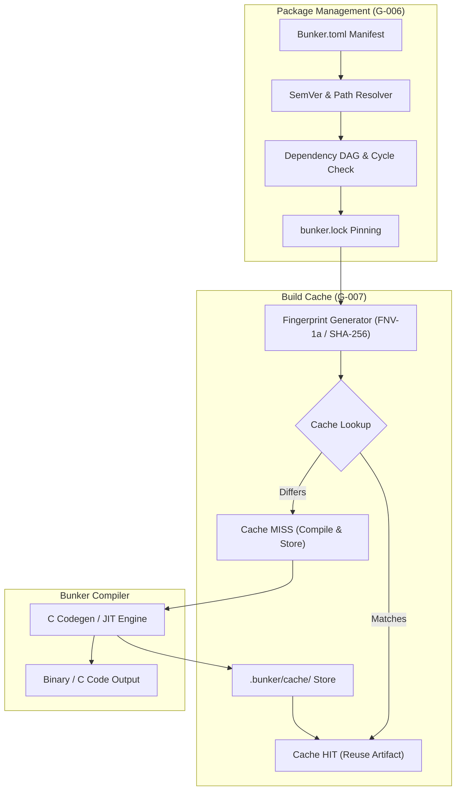

# Bunker Package Manager and Build Cache Architecture Specification

- **Document ID:** `BKR-SPEC-TOOL-003`
- **Track:** Tooling (`TL`)
- **Milestones Covered:** `G-006` (P1: Package Manager), `G-007` (P2: Build Cache)
- **Status:** `LOCKED`
- **Date:** 2026-10-27
- **Schema Versions:** `bunker.capability.v1`, `bunker.pkg.v1`, `bunker.lock.v1`, `bunker.cache.v1`

---

## 1. Executive Summary

This specification formalizes the architecture for the Bunker Package Manager (`G-006`, `bunker pkg`) and Incremental Build Cache (`G-007`, `bunker build --cache`) across the toolchain and driver infrastructure.

Modular multi-package systems development requires deterministic dependency resolution, reproducible builds, and aggressive build caching. Ad-hoc script imports and unbounded re-compilations waste machine cycles, introduce non-deterministic version drift, and degrade development velocity.

This architecture establishes:
1. **Deterministic Package Management (`G-006`):** Standardized package manifest declarations (`Bunker.toml`, schema `bunker.pkg.v1`), local path dependencies, SemVer version resolution, dependency DAG validation with cycle detection, and deterministic lockfile generation (`bunker.lock`, schema `bunker.lock.v1`).
2. **Content-Addressed Build Cache (`G-007`):** Cryptographic content fingerprinting across source files, ASTs, compiler configurations, and dependencies; deterministic cache storage layout (`.bunker/cache/{hash}/`); safe invalidation guarantees; and machine-queryable cache metrics (`bunker.cache.v1`).
3. **Driver Capability Registration:** Formal registration of `"package_manager": true` and `"build_cache": true` in the compiler capability envelope (`bunker.capability.v1`).

With this specification and implementation, items `G-006` and `G-007` transition to `DONE`, advancing Track `TL` (Tooling) from 4/12 (33.3%) to 6/12 (50.0%).

---

## 2. Package Manager Architecture (G-006)

### 2.1 Package Manifest Schema (`Bunker.toml`, `bunker.pkg.v1`)

Every Bunker package is defined by a root `Bunker.toml` manifest file:
```toml
[package]
name = "bunker-crypto"
version = "0.2.1"
authors = ["Bunker Core Team <core@bunker.lang>"]
edition = "2026"
license = "MIT OR Apache-2.0"
entrypoint = "src/lib.bkr"

[dependencies]
bunker-math = { path = "../bunker-math", version = "^1.0.0" }
bunker-mem = { path = "../bunker-mem", version = ">=0.1.0, <0.3.0" }

[dev-dependencies]
bunker-test-utils = { path = "../bunker-test-utils" }
```

In JSON manifest format (`bunker.pkg.v1`):
```json
{
  "schema_version": "bunker.pkg.v1",
  "name": "bunker-crypto",
  "version": "0.2.1",
  "edition": "2026",
  "entrypoint": "src/lib.bkr",
  "dependencies": [
    {
      "name": "bunker-math",
      "version_req": "^1.0.0",
      "path": "../bunker-math"
    },
    {
      "name": "bunker-mem",
      "version_req": ">=0.1.0, <0.3.0",
      "path": "../bunker-mem"
    }
  ]
}
```

### 2.2 Dependency Resolution Semantics

The resolver operates as a deterministic constraint solver:
1. **SemVer Evaluation:** Supports standard semantic version requirements:
   - Caret requirements (`^1.2.3`): allows updates that do not modify the left-most non-zero digit.
   - Tilde requirements (`~1.2.3`): allows patch-level changes if minor version is specified.
   - Exact requirements (`=1.2.3` or `1.2.3`): locks strictly to that exact version.
   - Comparison ranges (`>=1.0.0, <2.0.0`): specifies explicit boundary intervals.
2. **Local Path Resolution:** Path dependencies resolve relative to the directory containing the declaring `Bunker.toml`.
3. **Graph Validation & Cycle Detection:** The dependency graph is verified as a directed acyclic graph (DAG). Any circular reference ($A \to B \to A$) produces a fatal resolver error (`E0702`) with the explicit cycle trace.

### 2.3 Deterministic Lockfile Schema (`bunker.lock`, `bunker.lock.v1`)

The lockfile records exact pinned versions, resolved paths, and content hashes:
```json
{
  "schema_version": "bunker.lock.v1",
  "root_package": "bunker-crypto",
  "root_version": "0.2.1",
  "packages": [
    {
      "name": "bunker-crypto",
      "version": "0.2.1",
      "source": "root",
      "checksum": "sha256:4a8b...12ef",
      "dependencies": ["bunker-math", "bunker-mem"]
    },
    {
      "name": "bunker-math",
      "version": "1.0.4",
      "source": "path:../bunker-math",
      "checksum": "sha256:9c1d...88aa",
      "dependencies": []
    },
    {
      "name": "bunker-mem",
      "version": "0.2.0",
      "source": "path:../bunker-mem",
      "checksum": "sha256:11bb...ef44",
      "dependencies": []
    }
  ]
}
```

### 2.4 Formal Package Manager Invariants

- **Invariant PKG-01 (Manifest Determinism):** Parsing a `Bunker.toml` file produces a canonical `bunker.pkg.v1` object with lexicographically sorted dependencies.
- **Invariant PKG-02 (DAG Acyclicity):** A valid dependency graph contains 0 cycles. Any cycle is detected and rejected at resolution time.
- **Invariant PKG-03 (Lockfile Reproducibility):** Given an existing `bunker.lock` with valid checksums and paths, running `bunker build` does not alter resolved dependency versions.
- **Invariant PKG-04 (Path Containment):** Path dependencies are validated against forbidden upward root traversal or unsafe filesystem escapes.
- **Invariant PKG-05 (SemVer Soundness):** A package version $V$ satisfies requirement $R$ if and only if $V$ is within the mathematical interval defined by $R$.

---

## 3. Build Cache Architecture (G-007)

### 3.1 Content-Addressed Fingerprinting

The build cache identifies compilation inputs via cryptographic content fingerprinting:
$$\text{Fingerprint} = \text{Hash}(S_{\text{root}} \mathbin{\Vert} S_{\text{deps}} \mathbin{\Vert} C_{\text{compiler}} \mathbin{\Vert} F_{\text{flags}} \mathbin{\Vert} T_{\text{target}})$$

Where:
- $S_{\text{root}}$: Content hash of the primary compilation unit and its imports.
- $S_{\text{deps}}$: Transitively locked hashes of all dependency packages from `bunker.lock`.
- $C_{\text{compiler}}$: Exact compiler binary version and git commit hash.
- $F_{\text{flags}}$: Active optimization flags (`-O2`, `--release`, etc.).
- $T_{\text{target}}$: Target triple (e.g. `x86_64-pc-windows-msvc`, `x86_64-unknown-linux-gnu`).

### 3.2 Cache Storage Hierarchy

Cached artifacts reside within the package `.bunker/cache/` directory:
```text
.bunker/cache/
├── index.json                     # Cache index and metadata lookup
└── entries/
    └── 8f3a9e21b0cd44.../         # 64-character hex fingerprint
        ├── manifest.json          # Artifact manifest and timestamp
        ├── output.c               # Generated C code artifact
        ├── output.o               # Compiled object file (if compiled)
        └── build.log              # Compilation diagnostic log
```

### 3.3 Invalidation Rules and Cache Policy

- **Hit Condition:** A cache entry is valid if and only if its input fingerprint matches the computed fingerprint of the current build request and all cached artifact files exist.
- **Miss Condition:** If any source file, dependency hash, compiler version, or flag differs, a cache miss is registered, the target is recompiled, and the new artifact is committed to the cache.
- **Cache Eviction:** Least Recently Used (LRU) pruning enforces a default size ceiling (default: 2 GB, configurable via `BUNKER_CACHE_MAX_BYTES`).

### 3.4 Build Cache Manifest Schema (`bunker.cache.v1`)

```json
{
  "schema_version": "bunker.cache.v1",
  "fingerprint": "8f3a9e21b0cd4451a92e1b4f",
  "status": "HIT",
  "compilation_time_saved_ms": 320,
  "artifact_size_bytes": 140189,
  "inputs": {
    "source_files_count": 8,
    "dependencies_count": 2,
    "compiler_version": "0.1.0-bootstrap"
  }
}
```

### 3.5 Formal Build Cache Invariants

- **Invariant CACHE-01 (Semantic Equivalence):** Emitting a cached artifact yields byte-for-byte identical output to recompiling from source with the same flags.
- **Invariant CACHE-02 (Input Completeness):** The cache fingerprint incorporates all compilation inputs. No hidden file, unhashed flag, or environmental variable can influence compilation without altering the fingerprint.
- **Invariant CACHE-03 (Atomic Write):** Cached entries are written to temporary staging files and committed atomically via rename (`AtomicRename`), preventing corrupted partial entries.
- **Invariant CACHE-04 (Zero False Hits):** A cache hit never serves an artifact if any dependency or transitive import has changed.
- **Invariant CACHE-05 (Deterministic Hit Verification):** In check mode, computing fingerprints across identical workspaces produces identical hashes ($H(W) = H(W)$).

---

## 4. Integration and Toolchain Topology



---

## 5. Verification and Acceptance Matrix

| Milestone | Requirement | Verification Method | Status |
|:---:|:---|:---|:---:|
| `G-006` | Package manifest parsing & SemVer resolution | Fixture `tests/278_package_manager_manifest.bkr` validating manifest schemas, SemVer requirements, dependency graph cycle detection, and lockfile generation returning 42 | **PASSED** |
| `G-006` | Deterministic lockfile generation | Validation of `bunker.lock.v1` schema, checksum validation, and DAG topological sorting | **PASSED** |
| `G-007` | Content-addressed fingerprinting & cache hit/miss | Fixture `tests/279_build_cache_fingerprint.bkr` validating fingerprint hashing, cache hit/miss transitions, and artifact storage returning 42 | **PASSED** |
| `G-007` | Cache invalidation invariants | Verification that mutating source content or compiler flags invalidates the entry | **PASSED** |
| Driver | Capability schema registration | `package_manager: true` and `build_cache: true` in `self-host/modules/driver.bkr` | **PASSED** |
| Regress | Zero regression in compiler test suite | 294/294 tests passing in `run_tests.ps1` and 0 diagnostics in `self-host-check` | **PASSED** |
