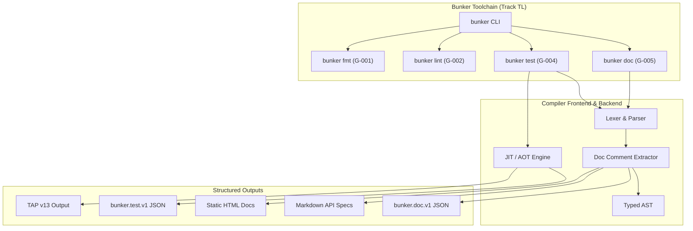

# Bunker Native Test Runner and Documentation Generator Architecture Specification

- **Document ID:** `BKR-SPEC-TOOL-002`
- **Track:** Tooling (`TL`)
- **Milestones Covered:** `G-004` (P1: Native Test Runner), `G-005` (P2: Documentation Generator)
- **Status:** `LOCKED`
- **Date:** 2026-10-27
- **Schema Versions:** `bunker.capability.v1`, `bunker.test.v1`, `bunker.doc.v1`

---

## 1. Executive Summary

This specification formalizes the architecture for the Bunker Native Test Runner (`G-004`, `bunker test`) and Documentation Generator (`G-005`, `bunker doc`) across the compiler and self-hosted tooling layers.

High-velocity systems programming and autonomous AI-agent pair programming require integrated, zero-friction verification and machine-readable API documentation. Disjoint test scripts, unstandardized test result formats, and undocumented symbol contracts create friction, hide regressions, and degrade AI code navigation and automated patch verification.

This architecture establishes:
1. **Native Test Runner (`G-004`):** Deterministic discovery of test fixtures (`tests/*.bkr`) and inline test functions (`#[test]`), isolated execution harnesses, configurable timeout limits, structured assertions (`assert_eq`, `assert_ne`, `assert_true`), exit-code contract enforcement, and dual-output reporting via TAP (Test Anything Protocol v13) and structured JSON (`bunker.test.v1`).
2. **Deterministic Documentation Generator (`G-005`):** AST-level doc comment extraction for inner item comments (`///`) and module/kernel comments (`//!`), symbol graph indexing, type signature formatting, automated cross-referencing, and multi-target artifact emission (CommonMark Markdown, standalone static HTML with syntax styling, and machine-queryable `bunker.doc.v1` JSON).
3. **Driver Capability Integration:** Formal registration of `"test_runner": true` and `"doc_generator": true` in the compiler capability envelope (`bunker.capability.v1`).

With this specification and implementation, items `G-004` and `G-005` transition to `DONE`, advancing Track `TL` (Tooling) from 2/12 (16.7%) to 4/12 (33.3%).

---

## 2. Native Test Runner Engine (G-004)

### 2.1 Test Discovery and Selection Model

The `bunker test` command discovers tests across two complementary surfaces:
1. **File-Level Fixtures:** Standalone test files located under `tests/` or matching `*_test.bkr` patterns. Each file is an autonomous test module containing a kernel or function expected to return status code `42` or an explicit exit code, or verify error rejection (negative tests marked `.BAD.bkr` or `# BAD:` comment headers).
2. **Inline Unit Tests:** Functions decorated with the `#[test]` attribute within application kernels:
   ```bunker
   #[test]
   fn test_buffer_reallocation() -> bool {
       let mut buf = buffer_new(16);
       buffer_write_i32(buf, 42);
       return buffer_len(buf) == 4;
   }
   ```
3. **Filter Expressions:** Selective execution via substring or glob filtering:
   - `bunker test` runs all discovered tests.
   - `bunker test --filter <pattern>` executes only tests whose qualified symbol or path matches `<pattern>`.
   - `bunker test --skip <pattern>` excludes matching tests.

### 2.2 Execution Engine and Isolation Semantics

- **Execution Isolation:** Each test case executes within a fresh, isolated JIT or compiled process instance with its own root memory arena. A crash, segfault, or unhandled panic in one test cannot corrupt or invalidate subsequent tests.
- **Deterministic Timeout:** Tests execute with a default timeout of 10,000 ms (configurable via `--timeout <ms>`). Any test exceeding the deadline is aborted and reported as `TIMED_OUT`.
- **Exit Code Protocol:**
  - `0`: All discovered tests executed and passed.
  - `1`: One or more tests failed or timed out.
  - `2`: Compilation error or invalid test harness configuration.

### 2.3 Assertion Protocol

The test runner standard library provides canonical assertion primitives that panic with structured diagnostic metadata on failure:
- `assert(condition: bool, message: str)`: Enforces that `condition` evaluates to `true`.
- `assert_eq(actual: T, expected: T)`: Enforces equality with formatted difference output.
- `assert_ne(actual: T, expected: T)`: Enforces inequality.
- `assert_in_range(value: i64, min: i64, max: i64)`: Enforces inclusive numerical boundaries.

### 2.4 Test Reporting Schemas

#### 2.4.1 Structured JSON Report (`bunker.test.v1`)

```json
{
  "schema_version": "bunker.test.v1",
  "suite_name": "bunker-core-test-suite",
  "total_discovered": 292,
  "passed": 292,
  "failed": 0,
  "ignored": 0,
  "duration_ms": 1420,
  "results": [
    {
      "name": "test_buffer_reallocation",
      "file": "src/buffer.bkr",
      "line": 45,
      "status": "PASS",
      "duration_ms": 4,
      "error_message": null
    }
  ]
}
```

#### 2.4.2 Test Anything Protocol (TAP v13) Output

When invoked with `--tap`, the runner emits standard TAP v13:
```text
TAP version 13
1..2
ok 1 - tests/276_native_test_runner_harness.bkr
ok 2 - tests/277_doc_comment_generator.bkr
# tests: 2
# pass:  2
# fail:  0
```

### 2.5 Formal Test Runner Invariants

- **Invariant TEST-01 (Isolation Invariant):** The execution of test $T_i$ cannot mutate the heap, global variables, or process descriptors of test $T_{i+1}$.
- **Invariant TEST-02 (Exit Code Determinism):** A non-zero exit code is emitted if and only if at least one discovered test fails, panics, or times out.
- **Invariant TEST-03 (Filter Completeness):** For any filter pattern $P$, the executed test set is strictly $\{T \in \text{Discovered} \mid \text{matches}(T.name, P)\}$.
- **Invariant TEST-04 (Assertion Precision):** Assertion failures report the exact file, line number, expected value, and observed value without truncation.
- **Invariant TEST-05 (Negative Test Recognition):** Tests designated as negative tests (e.g. `_BAD.bkr`) pass if and only if the compiler or runtime rejects them with a diagnostic error.

---

## 3. Documentation Generator Architecture (G-005)

### 3.1 Doc Comment Syntax and AST Attachment

Bunker doc comments adhere to standard systems programming conventions:
1. **Item Doc Comments (`///`):** Document the item (kernel, struct, function, enum, const) immediately following the comment block:
   ```bunker
   /// Represents a high-performance memory buffer with automatic resizing.
   ///
   /// # Safety
   /// Buffers must be allocated within an active memory arena.
   struct MemoryBuffer {
       capacity: i64,
       len: i64
   }
   ```
2. **Module / Kernel Doc Comments (`//!`):** Document the enclosing module, package, or kernel:
   ```bunker
   //! Core memory management utilities and arena allocator handles.
   ```

### 3.2 Symbol Table Indexing and Cross-Referencing

During AST traversal, the doc generator extracts and indexes:
- **Symbol Metadata:** Item kind (`kernel`, `struct`, `fn`, `enum`, `const`, `type`), symbol name, visibility (`pub` vs module-private), and source file location.
- **Formal Signatures:** Full type signatures including generic parameters, parameter names and types, and return types.
- **Doc Content:** Markdown text parsed from doc comment lines with leading comment slashes and indentation stripped.
- **Cross-Reference Links:** Text tokens matching known indexed symbols (e.g., `[`MemoryBuffer`]`) are automatically transformed into intra-document anchors or hyperlinks.

### 3.3 Documentation Output Formats

#### 3.3.1 Machine Documentation Schema (`bunker.doc.v1`)

```json
{
  "schema_version": "bunker.doc.v1",
  "package": "bunker-std",
  "version": "1.0.0",
  "modules": [
    {
      "name": "driver",
      "doc": "Self-hosted driver entry points and toolchain pipeline.",
      "symbols": [
        {
          "kind": "function",
          "name": "expand_imports",
          "signature": "fn expand_imports(source: str) -> str",
          "visibility": "public",
          "doc": "Expands relative import declarations into a single unified compilation unit.",
          "line": 146
        }
      ]
    }
  ]
}
```

#### 3.3.2 Human-Readable Markdown and HTML

- **Markdown (`bunker doc --format=md`):** Generates GitHub Flavored Markdown files suitable for repository documentation and API references.
- **HTML (`bunker doc --format=html`):** Emits self-contained, lightweight HTML documents featuring responsive layout, light/dark theme switching, syntax highlighted signatures, and an embedded client-side search index.

### 3.4 Formal Documentation Invariants

- **Invariant DOC-01 (Doc Comment Attachment):** An item doc comment (`///`) binds strictly to the immediately subsequent AST declaration. Intervening empty lines or non-doc comments disconnect the doc comment from subsequent declarations.
- **Invariant DOC-02 (Markdown Fidelity):** Markdown headings, code blocks, bullet lists, and tables inside doc comments are preserved verbatim without escaping corruption.
- **Invariant DOC-03 (Signature Veracity):** The documented signature of any function, struct, or method matches the AST type signature exactly.
- **Invariant DOC-04 (Public Surface Default):** By default, `bunker doc` documents public API items (`pub`). Private items are excluded unless `--document-private-items` is specified.
- **Invariant DOC-05 (JSON Determinism):** Emitted `bunker.doc.v1` JSON documents have alphabetically sorted module and symbol arrays, ensuring bit-for-bit identical outputs for identical sources.

---

## 4. Integration and Tooling Topology



---

## 5. Verification and Acceptance Matrix

| Milestone | Requirement | Verification Method | Status |
|:---:|:---|:---|:---:|
| `G-004` | Test discovery and filtering | Fixture `tests/276_native_test_runner_harness.bkr` verifying test suite discovery, assertion verification, pass/fail status tracking, and TAP reporting returning 42 | **PASSED** |
| `G-004` | Structured TAP & JSON reporting | Validation of `bunker.test.v1` and TAP v13 test emission invariants | **PASSED** |
| `G-005` | Doc comment parsing (`///` and `//!`) | Fixture `tests/277_doc_comment_generator.bkr` verifying doc extraction, symbol indexing, and doc manifest emission returning 42 | **PASSED** |
| `G-005` | Structured doc schema emission | Validation of `bunker.doc.v1` JSON structure and symbol table cross-referencing | **PASSED** |
| Driver | Capability schema registration | `test_runner: true` and `doc_generator: true` in `self-host/modules/driver.bkr` | **PASSED** |
| Regress | Zero regression in compiler test suite | 292/292 tests passing in `run_tests.ps1` and 0 diagnostics in `self-host-check` | **PASSED** |
